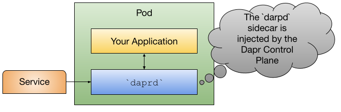
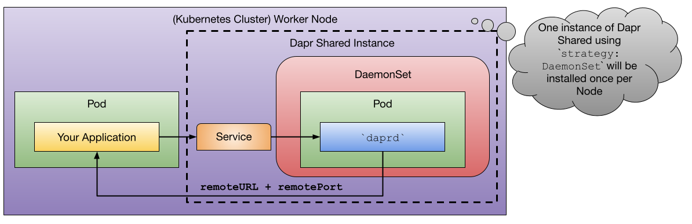
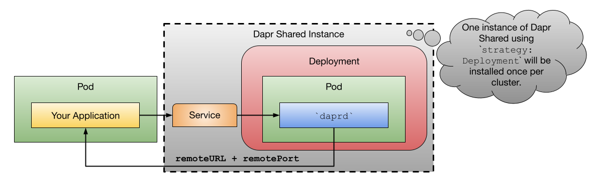

# Dapr Shared

[](https://github.com/dapr/dapr-shared/actions/workflows/dapr-shared.yaml)
[](LICENSE)

Dapr Shared runs the Dapr runtime (`daprd`) on Kubernetes as a shared `DaemonSet` or `Deployment` instead of a per-pod sidecar. [Dapr](https://dapr.io) is a portable, event-driven runtime that provides APIs for building distributed applications. For more details, see the [Dapr Shared documentation](https://docs.dapr.io/operations/hosting/kubernetes/kubernetes-dapr-shared/).

Dapr Shared allows you to create Dapr Applications using the `daprd` Sidecar as a Kubernetes `Daemonset` or `Deployment`. This enables other use cases where Sidecars are not the best option.

By running `daprd` as a Kubernetes `DaemonSet` resource, the `daprd` container will be running in each Kubernetes Node, reducing the network hops between the applications and Dapr. You can also choose to run Dapr Shared as a Kubernetes `Deployment`, in which case, the Kubernetes scheduler will decide in which node the Dapr Shared instance will run.

For each Dapr Application, you need to deploy this chart using different `shared.appId`s.

## Why Dapr Shared? 

By default, when Dapr is installed into a Kubernetes Cluster, the Dapr Control Plane is in charge of injecting the `daprd` sidecar to workloads annotated with  Dapr annotations (`dapr.io/enabled: "true"`). This mechanism delegates the responsibility of defining which workloads will be interacting with the Dapr APIs to the team in charge of deploying and configuring these workloads. Sidecars had the advantage of being co-located with your applications, so all communication between the application and the sidecar happens without involving the network.



While sidecars are the default strategy, there are some use cases that require other approaches. For example, you want to decouple the lifecycle of your workloads from the Dapr APIs. A typical example of this is Functions, or function as a service runtimes, which might automatically downscale your idle workloads to free up resources. For such cases, keeping the Dapr APIs and all the Dapr async functionalities (such as subscriptions) might be required. Dapr Shared was created exactly for this kind of scenario. 

Dapr Shared extends the Dapr sidecar model with two new deployment strategies: `DaemonSet` and `Deployment`.

No matter which strategy you choose, it is important to understand that in most use cases you will have one instance of Dapr Shared (Helm Release) per service (app-id). This means that if you have an application composed by three microservices, each service is recommended to have its own Dapr Shared instance. Check the [step-by-step tutorial using Kubernetes KinD here](docs/tutorial/README.md), to see an application using Dapr Shared.

### Dapr Shared: DaemonSet strategy

[Kubernetes `DaemonSets`](https://kubernetes.io/docs/concepts/workloads/controllers/daemonset/) allows you to define workloads that need to be deployed once per node in the cluster. This enables workloads that are running in the same node to communicate with local `daprd` APIs, no matter where the Kubernetes Scheduler schedules your workload. 



Note that DaemonSet, because it installs one instance per node, will consume more overall resources in your cluster.

### Dapr Shared: Deployment strategy

[Kubernetes `Deployments`](https://kubernetes.io/docs/concepts/workloads/controllers/deployment/) in the other hand, are installed once per cluster and the Kubernetes Scheduler decides, based on available resources, in which node the workload will be scheduled. For Dapr Shared, this means that your workload and the `daprd` instance might be located in separate nodes, which can introduce considerable network latency. 




## Getting Started

Before installing Dapr Shared, please ensure you have Dapr installed in your cluster.

If you want to get started with Dapr Shared, you can easily create a new Dapr Shared instance by installing the official Helm Chart:

```
helm install my-shared-instance oci://registry-1.docker.io/daprio/dapr-shared-chart --set shared.appId=<DAPR_APP_ID> --set shared.remoteURL=<REMOTE_URL> --set shared.remotePort=<REMOTE_PORT>
```

If you want to look at a step-by-step tutorial using some applications and interacting with Dapr Components, check out the [step-by-step tutorial using Kubernetes KinD here](docs/tutorial/README.md).

## From Source

To deploy this chart from the source you can run from inside the `chart/dapr-shared` directory:

```
helm install my-shared . --set shared.appId=<DAPR_APP_ID> --set shared.remoteURL=<REMOTE_URL> --set shared.remotePort=<REMOTE_PORT>

```

Where `<DAPR_APP_ID>` is the Dapr App Id that you can use in your components (for example, for scopes) and `<REMOTE_URL>` and `<REMOTE_PORT>` are a reachable URL and Port where the `dapr-shared` instance will forward subscriptions received by the Dapr sidecar.


## Customize Dapr Shared

Customize Dapr Shared using custom Helm values. See the [chart README](chart/dapr-shared/README.md) for the list of available values, and [`values.yaml`](chart/dapr-shared/values.yaml) for their current defaults.

### Building from source

The [CNCF `ko` project](https://ko.build/) is used to build multiplatform images for the proxy.
You can run the following command to build containers for the `dapr-shared` proxy:

```
ko build --platform=linux/amd64,linux/arm64
```
